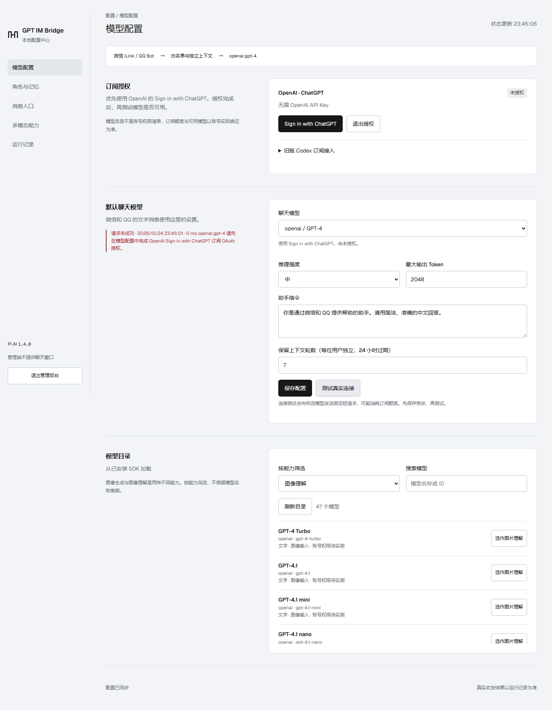

# GPT IM Bridge

[](https://github.com/skw736542-arch/gpt-im-bridge/actions/workflows/ci.yml) · [MIT](LICENSE)

**在你自己的设备上，从零把自己的 ChatGPT 订阅接入自己的 QQ，创建可自定义身份、记忆、声音与交流节奏的 AI 恋爱陪伴。**

A self-hosted QQ companion built around your own ChatGPT subscription, with optional WeChat support.

先读 [从零创建你的 QQ 陪伴角色](START_HERE.md)。公版默认名字为“小伴”，名称和性格由部署者自行设置；不附带任何人的 QQ 账号、订阅授权或私人记忆。网页用于管理，聊天留在 QQ 中。

**0.9.0-alpha.1 · MIT · single-owner deployment.** Independent community software, not an OpenAI, Tencent or gateway vendor product. No unlimited quota, QQ social posting or real-time calls.

## 功能与范围

| 功能 | 实现与范围 |
| --- | --- |
| 模型配置 | Pi AI 1.4.0，真实 ChatGPT OAuth、模型目录、默认模型、参数及真实连接测试 |
| 消息入口 | 微信 iLink、QQ 官方机器人、OneBot v11 正向 WebSocket；普通 QQ 需另行取得并登录网关 |
| 角色与记忆 | 统一身份、隔离会话、近期话题、用户确认长期记忆；虚构 AI 角色，不宣称真人情感 |
| 主动交流 | 显式开启、指定名单、安静时段、限额；模型决定表达或静默，未回复不连续追发 |
| QQ 原生语音 | 独立语音引擎 → SILK → record；用户曾确认语音可播放，新音色需试听 |
| 语音输入 | 本地 Whisper，最长 60 秒 / 10 MB；非专业发音评分 |
| 图片/表情 | 视觉模型、GIF 有限抽帧、表情元数据；无图片时不假装看见 |
| 文档 | TXT/MD/CSV/JSON/PDF/DOCX/XLSX 等有限提取，不执行宏，扫描 PDF/旧 DOC/程序文件不支持 |
| 短视频 | 最多 120 秒 / 30 MB，有限抽帧和音轨识别，不是逐帧理解 |
| 生图 | 单独登录的本机 Codex CLI；可选独立计费 OpenRouter，不保证与聊天同一账号或额度池 |

手机端新增媒体测试见 [ACCEPTANCE.md](ACCEPTANCE.md)。微信原生语音输出仍停用。



## Windows 快速启动

安装 Node.js >=24.15，在源码目录执行：

```powershell
npm ci
npm run setup
npm run build
npm start
```

打开 http://127.0.0.1:8787 ，从本机 .env 读取 ADMIN_PASSWORD。模型配置 → Sign in with ChatGPT → 授权 → 选择对应 provider 模型 → 保存 → 测试真实连接。1455 端口必须空闲；回调成功页不等于令牌换取和模型请求都成功。

初始化生成独立管理密码与加密密钥。升级保留 .env 和 data；停服务后备份匹配的数据与密钥，缺失密钥无法恢复授权。不要上传运行数据。

## 消息入口

- 微信：在消息入口扫码，填写允许用户并开启，只处理允许的私聊。
- 普通 QQ：[QQ_PERSONAL_SETUP.md](QQ_PERSONAL_SETUP.md)。自行取得兼容网关、登录，保存本机 WS 地址和 access_token，检查托管账号，将另一个聊天账号加入白名单。控制台密码、网关令牌与 GPT 授权相互独立。
- 官方 QQ：[QQ_SETUP.md](QQ_SETUP.md)。使用 QQ 开放平台应用，与普通 QQ 网关配置分开。

空白名单拒绝聊天。群聊还需群白名单与 @。外部网关适用自己的许可和平台条件，本项目不附带或安装它们。

## 语音与媒体

基本 Python 环境需要 Python 3.10：

```powershell
powershell -ExecutionPolicy Bypass -File scripts/setup-voice.ps1
```

下载依赖与 Whisper 模型。Linux 对应 `sh scripts/setup-voice.sh`。文件解码测试：`.venv/Scripts/python.exe scripts/media-selftest.py`，Linux 用 .venv/bin/python。

本地 Qwen 的 CUDA 安装脚本及成年女声音色见 [LOCAL_VOICE.md](LOCAL_VOICE.md)。台湾华语为生成指令，不能保证自然度。Edge 在线语音向 Microsoft 发送文字，不扣 GPT 原生语音额度。

生图需另行安装 Codex CLI，以 ChatGPT 登录，再在后台选择该后端。CLI 账号与 Pi OAuth 独立管理。没有失败后自动转付费 API 的行为。更多限额及配置见 [MEDIA_FEATURES.md](MEDIA_FEATURES.md)。

## Linux 与 Docker

原生 Linux 文字核心执行相同 npm 步骤。管理与授权优先经 SSH 转发：

```sh
ssh -L 8787:127.0.0.1:8787 -L 1455:127.0.0.1:1455 user@server
```

Docker：在主机先执行 `npm run setup`，然后 `docker compose up --build -d`。compose 只向主机 127.0.0.1 发布 8787 和 1455，容器内 PI_OAUTH_CALLBACK_HOST=0.0.0.0 使临时回调能经过映射到达。其他 Codex/Pi 登录占用 1455 时先结束它们的流程。

镜像只有文字核心，不包含 Python、QQ 网关、Codex CLI 或模型。容器的 127.0.0.1 不等于 Windows 主机；普通 QQ 与本地语音/生图推荐原生同机部署。远程管理必须 HTTPS 和安全 Cookie，不应公开网关端口。

## 记忆与交流

`/role companion`、`/role coach`、`/role general` 切换风格，身份统一。`记住：内容` 明确保存；自动提出的记忆需“确认记忆”。`/memories` 查看、`/forget all` 删除、`/memory off` 停用、`/reset` 清短期上下文。记忆按平台、账号、群、发送者与模式隔离。

主动交流须管理员启用并指定私聊名单。用户可发送“关闭主动聊天”或 `/proactive off`；恢复不能越过管理员限制。

## 验证与文档

```sh
npm run typecheck
npm test
npm run build
npm run test:release
npm run test:ui
npm run test:docker
```

浏览器检查需要 Edge/Chrome 或 `npx playwright install chromium`。Docker 检查需要运行中的 Docker，使用临时容器/数据卷，校验登录、持久化、回调可达和错误 state 拒绝。它不代表真实 OpenAI 换取令牌通过。自动测试不发真实 QQ 消息。

[认证流程](AUTHENTICATION.md) · [数据去向](PRIVACY.md) · [安全报告](SECURITY.md) · [验收证据](ACCEPTANCE.md) · [变更记录](CHANGELOG.md) · [贡献指南](CONTRIBUTING.md) · [第三方归属](THIRD_PARTY_NOTICES.md)

代码采用 [MIT](LICENSE)。依赖、字体、网关、模型和服务保留各自许可。项目不宣称获批 OpenAI 支持计划或获得厂商背书。
